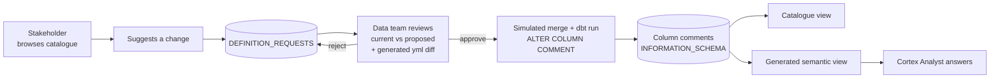

# Definitions everyone can trust

A self-service app that lets stakeholders browse column definitions, suggest changes, and lets a data team review and approve them. Approved definitions flow into the Snowflake column comments and into a semantic view, so an LLM (Cortex Analyst) answers questions using the improved wording.

Built for the **Snowflake AI Hackathon, London (21 October 2026)** on a Snowflake **trial account**, using **synthetic data only**.

## The story

A data team of two data engineers and no analysts, with busy product and engineering teams, still needs a trustworthy semantic layer for an LLM to answer questions about its data.

The starting point was to generate column definitions in the dbt `models.yml` files. They were drafted from the SQL that builds each column and from a business glossary a previous analyst wrote, and spot-checked against the platform's engineering code. dbt `persist_docs` pushes them into Snowflake column comments, and the same text feeds the semantic view, also built in dbt.

That is a good first draft, but not one to trust fully for real reports. The people who know the business need to help improve and maintain the definitions. This project is a small app that makes that possible without opening up the dbt repo to everyone.

What it does not solve: getting different departments to agree on one definition. That is a problem for another hackathon.

## What was built

1. **Catalogue.** Every column in the `MODEL` schema with its definition, domain and owner, with search and filters. It reads the live column comments from `INFORMATION_SCHEMA`, so there is no second copy of the definitions to drift.
2. **Suggest a change.** A form that stores a request (new text plus a reason) with status `PENDING`. It warns if the column already has pending requests.
3. **Review (data team).** Current vs proposed definition side by side, a generated diff of the model yml change, and approve or reject (a reason is required to reject).
4. **Simulate merge + dbt run.** Writes the approved text as the column comment (what `persist_docs` would do) and rebuilds the semantic view.
5. **Ask the data.** Calls Cortex Analyst on the semantic view and shows the generated SQL, the result, and the definitions in force at the time. Ask, approve a change, ask again: the answer changes.

### The demo result

On the synthetic data, "What is our total assets under custody in USD?" sums every daily balance snapshot, so the figure is almost 5x too high. After approving a clearer `BALANCE_USD` definition (use only the latest snapshot), the same question returns the correct figure. A second example does the same for `ORDER_STATUS` and traded volume (cancelled and pending orders drop out).

## Repository layout

| Path | What it is |
| --- | --- |
| `snowflake-setup/01_setup.sql` | Warehouse, database, schemas, roles, the four model tables with column comments (mimicking `persist_docs`), the catalogue view, and the requests table |
| `snowflake-setup/02_seed_data.sql` | Deterministic synthetic data, plus the two sample requests used in the demo |
| `snowflake-setup/03_semantic_view.sql` | Standalone copy of the semantic view the app generates, for testing the syntax in a Workspace |
| `snowflake-setup/04_quick_reset.sql` | Restores the demo definitions and requests between runs |
| `improve-def-app/` | The Streamlit app (`streamlit_app.py`) and its Snowflake CLI project (`snowflake.yml`, `pyproject.toml`) |

## Snowflake objects

| Object | Purpose |
| --- | --- |
| `HACKATHON_DB.MODEL.{CLIENTS, ORDERS, CLIENT_BALANCES, WALLETS}` | Synthetic model tables whose column comments are the definitions |
| `HACKATHON_DB.DEFINITIONS.COLUMN_DEFINITIONS` | View over `INFORMATION_SCHEMA.COLUMNS` joined to `TABLE_METADATA` |
| `HACKATHON_DB.DEFINITIONS.TABLE_METADATA` | Domain and owner per table (not part of `persist_docs`) |
| `HACKATHON_DB.DEFINITIONS.DEFINITION_REQUESTS` | Change requests. Status flow: `PENDING` then `APPROVED` or `REJECTED`, then `DEPLOYED` |
| `HACKATHON_DB.DEFINITIONS.DEFINITIONS_SV` | Semantic view, generated from the column comments |
| `HACKATHON_WH` | X-Small warehouse, auto-suspend 60 seconds |
| `PRODUCT_USER`, `DATA_TEAM` | Roles (granted to the creating user) |

## How to run it again

Requirements: a Snowflake account where you can use `ACCOUNTADMIN`, with Cortex Analyst available in the region (cross-region inference may need enabling).

1. In a Snowsight SQL Workspace, run `01_setup.sql`, then `02_seed_data.sql`.
2. Deploy the app from `improve-def-app/`. Either use the Snowflake CLI (`snow streamlit deploy --replace`) or create a Streamlit app in Snowsight and paste in `streamlit_app.py`.
   - `snowflake.yml` points at `COMPUTE_WH` and `SYSTEM_COMPUTE_POOL_CPU`. Change these to a warehouse and compute pool that exist in your account (the setup scripts create `HACKATHON_WH`).
3. Open the app, switch the sidebar to **Data team**, go to **Ask the data**, and click **Build / rebuild semantic view**. (`03_semantic_view.sql` does the same from SQL.)
4. Before Cortex Analyst is called from the app, check it works from Snowsight's own chat on `DEFINITIONS_SV`. If it does there, any remaining failure is the app, not the account.

### Demo flow (about 90 seconds)

1. Catalogue tab: search "balance" and show the vague `BALANCE_USD` definition.
2. Ask the data: "What is our total assets under custody in USD?" The answer is too high.
3. Sidebar: switch to Data team and enter an email. Review tab: open the `BALANCE_USD` request, check the diff, click Approve.
4. "Approved, awaiting deploy": click **Simulate merge + dbt run**.
5. Ask the same question again. The answer now matches the correct figure from the end of `02_seed_data.sql`.

### Reset between runs

Run `snowflake-setup/04_quick_reset.sql` (about 10 seconds), then rebuild the semantic view and click "Clear history" in the app. For a full reset, run `01`, `02`, then `03` again.

## How it works

- **Source of truth.** In production the definition lives in the dbt model yml. The app never edits it directly: an approval shows the exact yml change, and the real flow would open a PR.
- **Catalogue reads metadata, not a copy.** `persist_docs` writes `COMMENT` metadata on tables and columns. The catalogue view reads it back from `INFORMATION_SCHEMA`.
- **Semantic view generation.** `build_semantic_view_ddl()` in the app builds a `CREATE OR REPLACE SEMANTIC VIEW` statement from the live column comments (dimensions, facts, metrics, relationships). In production, a dbt macro that reads a model's column description would do this.
- **Cortex Analyst call.** On the warehouse runtime the app uses `_snowflake.send_snow_api_request`. On the container runtime, which has no `_snowflake` module, it falls back to calling the REST API over HTTPS with the session token. The container-runtime route is what the deployed app used.
- **Role gating.** A sidebar toggle shows or hides the Review tab and the "Build / rebuild" button (see limitations).

## What was simulated

| In this repo | In production |
| --- | --- |
| "Simulate merge + dbt run" writes the column comment directly | An approval opens a PR on the model yml, the data team merges it, dbt `persist_docs` applies it |
| The yml diff is generated from catalogue data | The diff is built from the real model yml file |
| The semantic view is regenerated by the app | The semantic view is a dbt model that deploys through CI |
| Sidebar role toggle | Snowflake roles and SSO |
| 25 synthetic clients, about 30 columns | Hundreds of models and over a thousand columns |

## Limitations

**Security and access**
- The role switch is a demo toggle, not access control. Anyone can switch to "Data team".
- The app runs with its owner's rights, so product users are not restricted at the database level.
- Requester and reviewer emails are typed in, not taken from the login, and a reviewer can approve their own request.

**Deployment chain**
- No real PR, CI run, or git history. The audit trail is a single table.
- Changes take effect instantly, with none of the delay between merge, dbt run and semantic view deploy.
- Rebuilding the semantic view uses `CREATE OR REPLACE`, so it briefly replaces the whole object.

**Semantic view and AI**
- The semantic view structure (tables, relationships, metrics) is hardcoded in the app. Only the comments follow the column definitions.
- Only the AuC metric inherits a column definition. Other metric comments are fixed text.
- Cortex Analyst may phrase the SQL differently between runs, and a better definition does not guarantee a different answer. Use the preset questions for repeatable demos.

**Workflow**
- No notifications, request history per column, versioning or rollback.
- Duplicate or conflicting requests only produce a warning. Approving one leaves others stale.
- Validation is minimal: length and "not identical". There is no check for vague wording or contradictions.
- Domain and owner come from a small metadata table, not from the dbt project.

**Platform**
- Built for a trial account, so it is tied to that account's region and runtime. The container-runtime REST fallback is best effort.
- The Snowflake trial account is temporary, so the live app no longer exists. Re-run the setup to rebuild it elsewhere.

## Future improvements

Roughly in order of value:

1. **Open a real PR on approval.** A GitHub Action (or API call) that edits the model yml description and opens a PR, with the request linked in the description. Mark the request `DEPLOYED` when the PR merges.
2. **Real access control.** SSO, Snowflake roles for submit vs review, and no self-approval.
3. **Reuse the yml text in the semantic view** through a dbt macro, so there is one definition and no regeneration step in the app.
4. **AI check on suggestions.** Use Cortex to flag vague or conflicting wording before it reaches the data team, and to pre-draft a definition for stakeholders to edit. Snowflake's own description generation could do the first draft.
5. **Measure the effect.** Use Cortex Analyst evaluations and verified queries to run a fixed set of test questions before and after each definition change.
6. **Notifications and entry points.** Slack messages for requesters and reviewers, and a way to suggest a change from where people already work (Slack, Streamlit Embed, or an AI assistant).
7. **Request history and conflict handling.** Show previous requests per column, merge or supersede duplicates, and support rollback.
8. **Link to the business glossary.** Show glossary terms next to the definition, and flag where a suggestion contradicts one.
9. **Scale the catalogue.** Pagination, ownership routing and filtering by domain for a warehouse of this size.

## Lessons learned

- A container-runtime Streamlit app has no `_snowflake` module, so calling Cortex Analyst needs either the warehouse runtime or a REST call with the session token. New apps may default to the container runtime.
- Check Cortex Analyst in Snowsight's own chat before debugging the app.
- Make the demo question and the definition wording specific. The AI only changes its answer if the new definition tells it how to compute the figure.
- Synthetic data with a deliberate flaw (five daily snapshots, cancelled orders) makes the before and after visible.
- Native Snowflake features cover generating and editing descriptions, discovery and lineage. I found no native flow for stakeholders to suggest a change that lands as a reviewed PR in dbt, but I did not read every documentation page, so check before claiming it does not exist.
